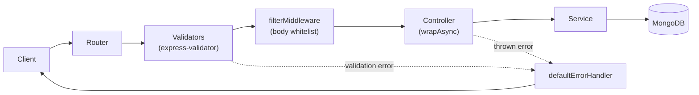

# 🛒 Shopping Cart Backend — User & Auth Service

A RESTful backend for a shopping-cart application, built with **Node.js, Express 5 and TypeScript** on **MongoDB**.
This repository contains the first service of the system: **user accounts and authentication** — registration, login, email verification, password recovery, profile management, JWT refresh-token rotation and image upload.


---

## ✨ Features

- **Layered architecture** — routes → middlewares → controllers → services → MongoDB, each layer with one job
- **JWT authentication with 4 token types**, each signed with its own secret and expiry:
  | Token | Purpose | Sent via |
  |---|---|---|
  | Access token | Authorize API calls | `Authorization: Bearer <token>` |
  | Refresh token | Get a new token pair (stored in DB, rotated on use) | Request body |
  | Email-verify token | Confirm the user's email address | Query string |
  | Forgot-password token | Reset a forgotten password | Request body |
- **Refresh-token rotation** — the old refresh token is deleted and a new pair is issued; logout revokes the token in the database
- **Declarative validation** with `express-validator` `checkSchema` (strong password, ISO 8601 dates, email format, length limits)
- **Centralized error handling** — a single error middleware returns a consistent JSON shape; async handlers are wrapped so no rejected promise is lost
- **Request body whitelisting** — `filterMiddleware` keeps only allowed fields (prevents mass-assignment, e.g. a user setting their own `role` or `verify`)
- **Account states** — `Unverified`, `Verified`, `Banned`; profile updates require a verified email
- **Image upload** — `formidable` parses multipart data (1 file, ≤ 300 KB, `image/*` only), `sharp` converts it to JPEG, then it is served from `/static/image/:filename`

---

## 🏗️ Architecture



**Request lifecycle:** a request passes through validators, which also verify and decode JWTs onto `req` (`req.decoded_authorization`, `req.decoded_refresh_token`, …). Controllers stay thin and delegate to services, which own all database access. Any error — validation or business — is forwarded with `next(err)` to one error handler.

---

## 📡 API Reference

Base URL: `http://localhost:3000`

### Users — `/users`

| Method | Endpoint | Auth | Body / Query | Description |
|---|---|---|---|---|
| POST | `/register` | — | `email, name, password, confirm_password, date_of_birth` | Create account, return token pair |
| POST | `/login` | — | `email, password` | Return access + refresh token |
| POST | `/logout` | Access | `refresh_token` | Revoke refresh token |
| POST | `/refresh-token` | — | `refresh_token` | Rotate token pair |
| GET | `/verify-email` | — | `?email_verify_token=` | Mark email as verified |
| POST | `/resend-verify-email` | Access | — | Issue a new email-verify token |
| POST | `/forgot-password` | — | `email` | Issue a forgot-password token |
| POST | `/verify-forgot-password` | — | `forgot_password_token` | Check the token before showing the reset form |
| POST | `/reset-password` | — | `forgot_password_token, password, confirm_password` | Set a new password |
| POST | `/me` | Access | — | Get own profile (sensitive fields excluded) |
| PATCH | `/me` | Access | `name, date_of_birth, bio, location, website, username, avatar, cover_photo` (all optional) | Update profile — verified users only |
| PUT | `/change-password` | Access | `old_password, password, confirm_password` | Change password while logged in |

### Media

| Method | Endpoint | Body | Description |
|---|---|---|---|
| POST | `/medias/upload-image` | `multipart/form-data`, field `image` | Upload one image, returns its URL |
| GET | `/static/image/:filename` | — | Serve an uploaded image |

### Error response format

```json
// 422 – validation error
{
  "message": "Validation Error",
  "errors": {
    "email": { "msg": "Email is invalid", "location": "body", "value": "abc" }
  }
}

// other handled errors (401, 404, 422…)
{ "message": "Refresh token is invalid" }
```

---

## 🚀 Getting Started

### Prerequisites
- Node.js 18+
- A MongoDB Atlas cluster (or adapt the connection string in `src/services/database.services.ts`)

### Installation

```bash
git clone https://github.com/khoadauvang/shoppingCartBE.git
cd shoppingCartBE
npm install
```

### Environment variables

Create a `.env` file in the project root:

```env
# MongoDB
DB_USERNAME=your_db_user
DB_PASSWORD=your_db_password
DB_NAME=shopping_cart
DB_USERS_COLLECTION=users
DB_REFRESH_TOKENS_COLLECTION=refresh_tokens

# Password hashing
PASSWORD_SECRET=change_me

# JWT secrets (use a different value for each)
JWT_SECRET_ACCESS_TOKEN=change_me
JWT_SECRET_REFRESH_TOKEN=change_me
JWT_SECRET_EMAIL_VERIFY_TOKEN=change_me
JWT_SECRET_FORGOT_PASSWORD_TOKEN=change_me

# Token lifetimes (format of the `ms` package)
ACCESS_TOKEN_EXPIRE_IN=15m
REFRESH_TOKEN_EXPIRE_IN=100d
EMAIL_VERIFY_TOKEN_EXPIRE_IN=7d
FORGOT_PASSWORD_TOKEN_EXPIRE_IN=7d
```

### Run

```bash
npm run dev      # development with hot reload (nodemon + ts-node)
npm run build    # compile TypeScript to dist/ and resolve path aliases
npm start        # run the compiled build
```

The server starts at `http://localhost:3000`.

### Scripts

| Script | Description |
|---|---|
| `npm run dev` | Start with nodemon, watching `src/` |
| `npm run build` | Clean `dist/`, compile with `tsc`, rewrite `~/` aliases with `tsc-alias` |
| `npm start` | Run `dist/index.js` |
| `npm run lint` / `lint:fix` | ESLint |
| `npm run prettier` / `prettier:fix` | Prettier |

---

## 📁 Project Structure

```
src/
├── index.ts                 # App entry: middleware, routers, error handler
├── type.d.ts                # Extends Express Request with decoded token fields
├── routes/                  # Endpoint definitions (users, medias, static)
├── middlewares/
│   ├── users.middleware.ts  # checkSchema validators + JWT verification
│   ├── common.middlewares.ts# filterMiddleware (body whitelist)
│   └── error.middlewares.ts # defaultErrorHandler
├── controllers/             # Thin HTTP layer
├── services/                # Business logic & MongoDB access
├── models/
│   ├── User.schema.ts       # User document
│   ├── RefreshToken.schema.ts
│   ├── Errors.ts            # ErrorWithStatus, EntityError
│   └── requests/            # Request body / token payload types
├── constants/               # HTTP status, messages, enums, upload dirs
└── utils/                   # jwt, crypto, validation, wrapAsync, file upload
```

---

## 🗺️ Roadmap

- [ ] Send verification and reset links by email (currently printed to the server console for development)
- [ ] Replace SHA-256 + secret with a slow, salted hash (bcrypt / argon2)
- [ ] TTL index on refresh tokens so expired tokens are removed automatically
- [ ] Unit and integration tests with Jest + Supertest
- [ ] Docker Compose setup (API + MongoDB)
- [ ] Rate limiting on login and forgot-password
- [ ] Next services: products, cart, orders

---

## 👤 Author

**Tran Anh Khoa** — Software Engineering student, FPT University HCMC
GitHub: [@khoadauvang](https://github.com/khoadauvang)
